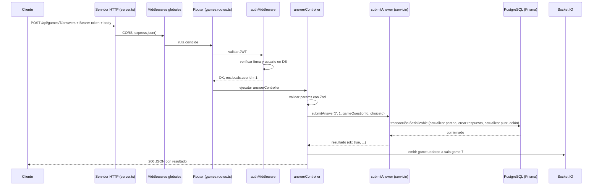

# Flujo de Ejecución del Backend

Este documento explica paso a paso cómo funciona el backend, desde el arranque hasta el recorrido de una petición HTTP real. Toda la información está basada en el código real del repositorio.

---

## 1. Arranque de la aplicación

### 1.1 Comando que inicia el proyecto

En desarrollo se ejecuta:

```bash
npm run dev
```

Este comando corresponde al script `"dev": "tsx watch --env-file-if-exists=.env src/server.ts"` definido en `package.json`.

- **`tsx watch`**: ejecuta TypeScript directamente sin compilación previa y vigila los cambios para reiniciar automáticamente.
- **`--env-file-if-exists=.env`**: carga las variables de entorno del archivo `.env` si existe.
- **`src/server.ts`**: es el primer archivo que se ejecuta.

### 1.2 Qué ocurre al ejecutar `src/server.ts`

### 1.3 Qué inicializaciones se producen al cargar `src/app.ts`

Cuando `server.ts` importa `app` desde `./app.js`, se ejecuta `src/app.ts`, que hace lo siguiente:

1. Crea la aplicación Express: `export const app = express()`.
2. Configura CORS con `origin: process.env.FRONTEND_ORIGIN` y `credentials: true`.
3. Monta Swagger UI en `/docs` usando la especificación generada por `swagger-jsdoc` desde `src/docs/swagger.ts`.
4. Expone el endpoint `GET /api/openapi.json` que devuelve el documento OpenAPI en JSON.
5. Aplica `express.json()` para convertir los cuerpos JSON de las peticiones en `req.body`.
6. Registra `jsonErrorMiddleware` para capturar errores de JSON mal formado.
7. Registra el endpoint `GET /` (mensaje de bienvenida).
8. Registra los routers agrupados por recurso:
   - `authRouter` bajo `/api/auth`
   - `questionRouter` bajo `/api/questions`
   - `categoryRouter` bajo `/api/categories`
   - `gameRouter` bajo `/api/games`
   - `meRouter` bajo `/api/me`
9. Registra `notFoundMiddleware` para rutas que no coinciden (404).
10. Registra `errorMiddleware` como último middleware para errores inesperados (500).

### 1.4 Cómo se registran las rutas, middlewares y componentes

- **Middlewares globales** (se aplican a todas las peticiones): CORS, `express.json()`, `jsonErrorMiddleware`. Se registran en `src/app.ts` antes de las rutas.

---

## 2. Recorrido de una petición HTTP real

El flujo general es:

```
Cliente → Servidor HTTP → Middlewares globales (CORS, JSON) → Router → Middleware de ruta (auth/admin) → Controlador → Servicio → Prisma → Base de datos → Servicio → Controlador → Respuesta JSON al cliente
```

Cuando ocurre un error en cualquier punto, el control pasa al middleware de errores global (`errorMiddleware` en `src/middlewares/error.middleware.ts`), que responde con `{ error: { code, message } }` y el estado HTTP correspondiente.

### Diagrama Mermaid del flujo general

```mermaid
graph TD
    A[Cliente] -->|Petición HTTP| B[Servidor HTTP / server.ts]
    B -->|Express app| C[Middlewares globales: CORS, express.json()]
    C -->|Ruta coincide| D[Router: src/routes/*.ts]
    D -->|Middleware de ruta| E[authMiddleware / adminMiddleware]
    E -->|req res| F[Controlador: src/controllers/*.ts]
    F -->|valida con Zod| G[Servicio: src/services/*.ts]
    G -->|Prisma| H[Base de datos PostgreSQL]
    H -->|resultado| G
    G -->|resultado| F
    F -->|respuesta JSON| I[Respuesta al cliente]
    E -->|error 401/403| J[Middleware de errores: errorMiddleware]
    F -->|error| J
    G -->|error| J
    J -->|JSON error| I
```

---

## 3. Ejemplo 1: Endpoint de lectura — `GET /api/questions`

### 3.1 Método HTTP y ruta

- **Método**: `GET`
- **Ruta**: `/api/questions`
- **Archivo donde se define la ruta**: `src/routes/questions.routes.ts` (línea: `questionRouter.get("/", getQuestionsController)`)
- **Montada en**: `src/app.ts` bajo el prefijo `/api/questions`

### 3.2 Middleware o validaciones que intervienen

No hay middleware de autenticación para este endpoint (es público). Las validaciones se hacen en el controlador:

- `paginationQuerySchema.safeParse(req.query)` valida `page`, `pageSize`, `search` y `categoryId` (definido en `src/schemas/query.schema.ts`).

### 3.3 Controlador y función ejecutada

- **Archivo**: `src/controllers/question.get.ts`
- **Función**: `getQuestionsController(req, res)`
- **Qué hace**:
  1. Valida los query params con `paginationQuerySchema`.
  2. Si no son válidos, responde 400 con `VALIDATION_ERROR`.
  3. Llama a `getQuestions({ page, pageSize, search, categoryId })` desde `src/services/question.service.js`.
  4. Mapea los resultados al formato público (elimina `solution`, deja solo `id`, `enunciado`, `categoryId`, `opciones`).
  5. Responde 200 con JSON `{ items, total, page, pageSize }`.

### 3.4 Servicios y funciones que se llaman

- **Archivo**: `src/services/question.service.ts` (barrel que reexporta)
- **Archivo real**: `src/services/question.queries.ts`
- **Función**: `getQuestions(params)`
- **Qué hace**:
  1. Construye el filtro `where` para Prisma (búsqueda por enunciado y filtro por categoría).
  2. Ejecuta en paralelo `prisma.question.findMany(...)` con paginación (`skip`, `take`) y `prisma.question.count({ where })`.
  3. Devuelve `{ items, total, page, pageSize }`.

### 3.5 Acceso a datos

- Usa `prisma` desde `src/lib/prisma.ts` (instancia de PrismaClient).
- Consulta las tablas `Question` y `Option` a través de Prisma ORM.
- No modifica datos, solo lectura.

### 3.6 Qué ocurre en caso de éxito

---

## 4. Ejemplo 2: Endpoint de creación/modificación — `POST /api/games/:id/answers`

### 4.1 Método HTTP y ruta

- **Método**: `POST`
- **Ruta**: `/api/games/:id/answers`
- **Archivo donde se define la ruta**: `src/routes/games.routes.ts` (línea: `gameRouter.post("/:id/answers", authMiddleware, answerController)`)
- **Montada en**: `src/app.ts` bajo el prefijo `/api/games`

### 4.2 Middleware o validaciones que intervienen

1. **`authMiddleware`** (`src/middlewares/auth.middleware.ts`): valida el token JWT en la cabecera `Authorization: Bearer <token>`, verifica que el usuario existe y guarda `res.locals.userId`.
2. **`idParamSchema`** (`src/schemas/question-id.schema.ts`): valida que `:id` sea un entero entre 1 y 2147483647.
3. **`answerSchema`** (`src/schemas/answer.schema.ts`): valida que el cuerpo tenga `gameQuestionId` y `choiceId`, ambos enteros en el rango válido.

### 4.3 Controlador y función ejecutada

- **Archivo**: `src/controllers/game.answer.ts`
- **Función**: `answerController(req, res)`
- **Qué hace**:
  1. Obtiene `userId` de `res.locals.userId` (puesto por `authMiddleware`).
  2. Valida `req.params` con `idParamSchema`; si falla, responde 400 con `PARTIDA_ID_INVALIDO`.
  3. Valida `req.body` con `answerSchema`; si falla, responde 400 con `VALIDATION_ERROR`.
  4. Llama a `submitAnswer(gameId, userId, gameQuestionId, choiceId)` desde `src/services/game.services.js`.
  5. Si `resultado.ok` es `false`, traduce el error del servicio a un código del catálogo y responde con el estado correspondiente.
  6. Si todo va bien, lee el estado fresco de la partida (`prisma.game.findUnique`) y emite `game:updated` por Socket.IO a la sala `game:${gameId}`.
  7. Responde según el modo:
     - **Individual**: `{ gameQuestionId, isCorrect, score, finished }`.
     - **Multijugador**: `{ gameQuestionId, roundComplete, finished, nextTurn, ...(roundComplete ? { results, players, winnerUserId, isDraw } : {}) }`.

### 4.4 Servicios y funciones que se llaman

- **Archivo**: `src/services/game.services.ts` (barrel)
- **Archivo real**: `src/services/game.mutations.ts`
- **Función**: `submitAnswer(gameId, userId, gameQuestionId, choiceId)`
- **Qué hace** (resumido):
  1. Valida que la partida exista, esté activa, que el usuario participe, que sea su turno, que la elección pertenezca a la pregunta, y que no haya respondido ya.
  2. Determina si la respuesta es correcta comparando con la solución guardada en `GameChoice`.
  3. Ejecuta una transacción de Prisma con nivel de aislamiento `Serializable`:
     - Intenta actualizar la partida con `turnVersion` como control de versión optimista (`WHERE turnVersion: game.turnVersion`). Si `count !== 1`, hay conflicto de versión.
     - Crea la respuesta en `Answer`.
     - Si es correcta, incrementa la puntuación del jugador en `GamePlayer`.
  4. Si hay error P2002 (duplicado en `Answer` por `gameQuestionId + userId`), devuelve `ALREADY_ANSWERED`.
  5. Si hay conflicto de versión o P2034, reintenta hasta 3 veces; si agota reintentos, devuelve `CONFLICTO_CONCURRENCIA`.
  6. Calcula el siguiente turno, si la ronda está completa, quién ganó, etc.
  7. Devuelve el resultado tipado (`SubmitAnswerResult`).

### 4.5 Acceso a datos

- Usa `prisma` desde `src/lib/prisma.ts`.
- Operaciones: `prisma.game.findUnique`, `prisma.game.updateMany`, `prisma.answer.create`, `prisma.gamePlayer.update`, todo dentro de `prisma.$transaction`.

### 4.6 Qué ocurre en caso de éxito

El cliente recibe un JSON con el resultado de la respuesta (individual o multijugador según el modo) y estado 200. Además, se emite `game:updated` por Socket.IO a los clientes conectados a la sala de la partida.

### 4.7 Qué ocurre si se produce un error

Cada error del servicio se traduce a un código de error y estado HTTP:

| Error del servicio | Código público | Estado HTTP | Significado |
|---|---|---|---|
| `GAME_NOT_FOUND` | `GAME_NOT_FOUND` | 404 | La partida no existe |
| `NOT_PARTICIPANT` | `FORBIDDEN` | 403 | El usuario no participa en la partida |
| `GAME_NOT_ACTIVE` | `GAME_NOT_ACTIVE` | 409 | La partida aún está en WAITING |
| `GAME_FINISHED` | `GAME_FINISHED` | 409 | La partida ya ha finalizado |
| `QUESTION_NOT_IN_GAME` | `QUESTION_NOT_IN_QUESTION` | 404 | Esa pregunta no pertenece a esta partida |
| `WRONG_TURN` | `WRONG_TURN` | 409 | No es tu turno o esa pregunta no está en juego |
| `CHOICE_NOT_IN_QUESTION` | `CHOICE_NOT_IN_QUESTION` | 400 | La opción no pertenece a esa pregunta |
| `ALREADY_ANSWERED` | `ALREADY_ANSWERED` | 409 | Ya has respondido esta pregunta |
| `CONFLICTO_CONCURRENCIA` | `CONFLICT` | 409 | Conflicto de concurrencia, inténtalo de nuevo |

### 4.8 Formato de la respuesta

**Individual (éxito):**
```json
{
  "gameQuestionId": 12,
  "isCorrect": true,
  "score": 2,
  "finished": false
}
```

**Multijugador (primera respuesta de la ronda):**
```json
{
  "gameQuestionId": 12,
  "roundComplete": false,
  "finished": false,
  "nextTurn": { "userId": 2, "gameQuestionId": 12 }
}

---

## 5. Eventos Socket.IO (tiempo real)

La configuración está en `src/sockets/index.ts`.

### 5.1 Conexión y autenticación

- El cliente se conecta con `io.connect(url, { auth: { token: "<JWT>" } })`.
- Un middleware de Socket.IO verifica el JWT con `JWT_SECRET`. Si falta o es inválido, rechaza la conexión.
- El `userId` se guarda en `socket.data.userId`.

### 5.2 Eventos cliente → servidor

- **`join:game`** (payload: `gameId`): comprueba que exista una fila `GamePlayer` para ese usuario y partida. Si pertenece, une el socket a la sala `game:${gameId}` y responde `joined:game`. Si no pertenece, responde `error:game`.

### 5.3 Eventos servidor → cliente

- **`joined:game`**: confirma que el cliente se unió a la sala.
- **`error:game`**: notifica un error al intentar unirse.
- **`game:updated`**: se emite tras guardar y confirmar una operación en la base de datos (después del commit). Envía solo datos públicos: `id`, `status`, `turnVersion`.

Se emite correctamente `"game:updated"` a la sala de la partida después de confirmar la operación en la base de datos.

---

## 6. Manejo de errores

### 6.1 Catálogos de errores

- **`src/errors/errorCatalog.ts`**: errores de negocio (validación, autenticación, permisos, recursos no encontrados, conflictos de estado). Cada entrada tiene `code` (público), `status` y `message`.
- **`src/errors/middlewareCatalog.ts`**: errores de middlewares (falta token, token inválido, JSON mal formado, ruta no encontrada, configuración faltante, error interno).

### 6.2 Funciones de respuesta

- **`responderError(res, code)`** (`src/errors/responderError.ts`): usa el catálogo de negocio para responder con el estado y mensaje adecuados.
- **`responderMiddlewareError(res, code)`** (`src/errors/responderMiddlewareError.ts`): usa el catálogo de middlewares.

### 6.3 Middlewares de error

- **`jsonErrorMiddleware`** (`src/middlewares/error.middleware.ts`): captura errores de JSON mal formado o payload demasiado grande.
- **`notFoundMiddleware`** (`src/middlewares/error.middleware.ts`): responde 404 para rutas no encontradas.
- **`errorMiddleware`** (`src/middlewares/error.middleware.ts`): último recurso, registra el error en consola y responde 500 con mensaje genérico (nunca detalles internos al cliente).

---

## 7. Diagrama de una petición real (POST /api/games/:id/answers)



```

**Multijugador (ronda completa):**
```json
{
  "gameQuestionId": 12,
  "roundComplete": true,
  "finished": false,
  "nextTurn": { "userId": 1, "gameQuestionId": 13 },
  "results": [
    { "userId": 1, "isCorrect": true },
    { "userId": 2, "isCorrect": false }
  ],
  "players": [
    { "userId": 1, "score": 1 },
    { "userId": 2, "score": 0 }
  ],
  "winnerUserId": null,
  "isDraw": false
}
```


El cliente recibe un JSON como:

```json
{
  "items": [
    {
      "id": 1,
      "enunciado": "¿Cuál es la capital de España?",
      "categoryId": 1,
      "opciones": ["Madrid", "Barcelona", "Valencia", "Sevilla"]
    }
  ],
  "total": 6,
  "page": 1,
  "pageSize": 10
}
```

### 3.7 Qué ocurre si se produce un error

- Si los query params son inválidos: responde 400 con `{ error: { code: "VALIDATION_ERROR", message: "Los datos enviados no son válidos" } }`.
- Si falla la base de datos: el error sube al middleware global `errorMiddleware`, que responde 500 con `{ error: { code: "INTERNAL_SERVER_ERROR", message: "Ha ocurrido un error interno en el servidor" } }`.

### 3.8 Formato de la respuesta

Estado 200, Content-Type `application/json`, cuerpo con `items`, `total`, `page`, `pageSize`.

- **Rutas**: se definen en `src/routes/*.ts` y se montan en `src/app.ts` usando `app.use("/api/auth", authRouter)`, etc.
- **Middlewares de ruta**: `authMiddleware` y `adminMiddleware` se aplican dentro de cada router, solo en las rutas que los necesitan.
- **Socket.IO**: se inicializa en `src/sockets/index.ts` como efecto secundario al importarse desde `src/server.ts`.

### 1.5 Cómo se inicia el servidor

El servidor se inicia con `server.listen()` en `src/server.ts`. Una vez que este método se ejecuta, Express está listo para recibir peticiones HTTP y Socket.IO está listo para aceptar conexiones WebSocket.


El archivo `src/server.ts` ejecuta lo siguiente, en este orden:

1. Importa `app` desde `./app.js` (esto provoca que se ejecute todo `src/app.ts`).
2. Importa `createServer` de `node:http` y crea el servidor HTTP con `createServer(app)`.
3. Importa `./sockets/index.js` (efecto secundario: configura Socket.IO sobre el mismo servidor HTTP).
4. Valida `JWT_SECRET`: si no está definida, lanza un error y detiene el arranque. También valida que tenga al menos 32 caracteres.
5. Valida `FRONTEND_ORIGIN`: si no está definida, lanza un error y detiene el arranque.
6. Lee y valida `PORT`: convierte a número y comprueba que sea un entero entre 1 y 65535.
7. Llama a `server.listen(port, "0.0.0.0")` para empezar a escuchar peticiones.
8. Imprime un mensaje de consola: `TriviaApp Backend disponible en http://localhost:${port}`.
